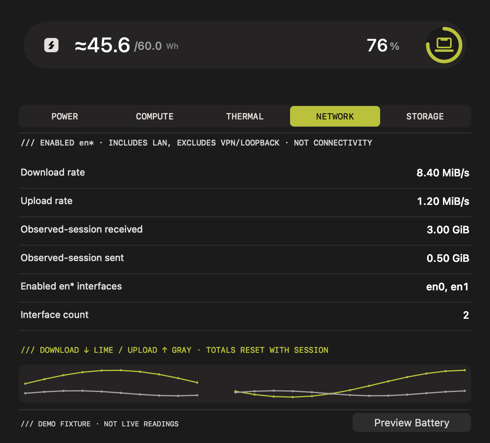
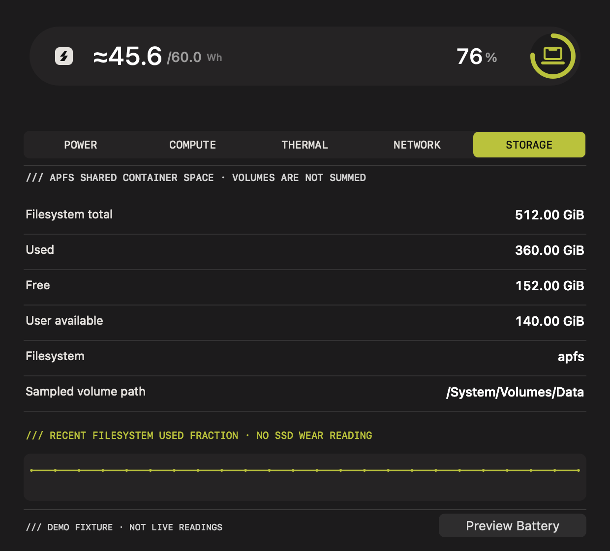
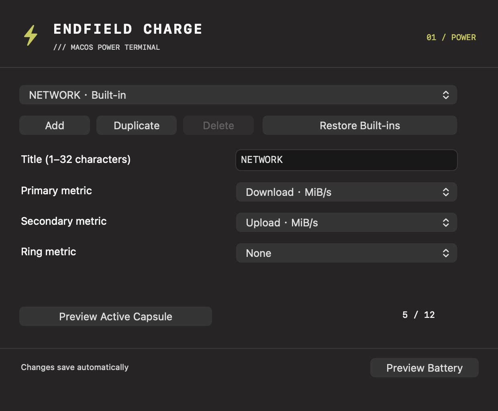

English | [简体中文](README.zh-CN.md)


# Endfield Charge

An Endfield-inspired battery HUD and local telemetry terminal for **macOS**.

See power changes at the top of your screen. Inspect system telemetry, choose a capsule layout, and define alerts without adding a web runtime.

[](https://github.com/MarkYang44/Endfield-Charge/releases/latest)


[](LICENSE)

**[Download for macOS](https://github.com/MarkYang44/Endfield-Charge/releases/latest)** · [Quick start](#quick-start) · [Documentation](#documentation)

## Overview

Endfield Charge is a native Swift/AppKit menu bar app. Connecting or disconnecting power reveals a three-stage animation: the bolt, a mode title, and a compact battery capsule. The charcoal, off-white and lime palette, geometric artwork and animation follow [QinAnze/zmd-charge](https://github.com/QinAnze/zmd-charge).

A separate telemetry window shows power, compute, thermal, network and storage readings. Capsule profiles and threshold rules share the resident sampler. English, Simplified Chinese and system-language modes are available; your settings survive upgrades.

## Screenshots

Actual AppKit exports using **demo data**, not measurements of your Mac. Settings exports show the content area; the macOS title bar and toolbar are omitted.

<table>
  <tr>
    <td width="50%"><strong>Battery capsule</strong><br></td>
    <td width="50%"><strong>Network telemetry</strong><br></td>
  </tr>
  <tr>
    <td><strong>Storage telemetry</strong><br></td>
    <td><strong>Capsule editor</strong><br></td>
  </tr>
</table>

## Core features

- **Power HUD:** original three-stage geometry and ripple directions, estimated Wh, battery percentage, charging state, multi-display placement and Reduce Motion support. The overlay does not take focus or intercept clicks.
- **Five telemetry modules:** battery-side power and adapter rating; CPU and estimated memory; system thermal state; enabled `en*` interface traffic; APFS Data volume capacity. Missing readings remain unknown.
- **Capsule profiles:** battery, CPU, memory, network and storage presets; up to 12 profiles with an editable title, primary/secondary metrics and an optional ring. Select a profile from the menu or preview it with your shortcut.
- **Alert rules:** up to 16 optional rules with a strict threshold, hold time, cooldown and recovery before rearming. New rules are disabled. Power events retain priority over generic alerts.
- **Native controls:** English / 简体中文 / system language, configurable global shortcut, optional login launch and menu bar percentage. Login launch is off by default.

## Installation

1. Download **`Endfield-Charge-macOS.zip`** from the [latest release](https://github.com/MarkYang44/Endfield-Charge/releases/latest).
2. Extract it and move **`Endfield Charge.app`** into **Applications**.
3. Open the app. Its icon appears in the **menu bar**.

Requires **macOS 13 or newer**. The release archive contains Apple Silicon and Intel code. No Swift, Python or other runtime installation is needed to use it. Replace the app when upgrading; preferences are stored separately.

Builds use an ad-hoc signature and are **not Apple-notarized**. If macOS blocks a downloaded copy, use its **Open** or **Privacy & Security** approval flow. Keep Gatekeeper enabled.

## Quick start

1. Click the menu bar icon and open **Settings → General** to choose your language and shortcut.
2. Use **Preview Battery** or connect/disconnect your charger to see the original HUD.
3. Open **Telemetry Terminal** for the five telemetry pages. Individual modules can be disabled in **Settings → Telemetry**.
4. Open **Settings → Capsules**, select or edit a profile, then use **Preview Active Capsule**.
5. Open **Settings → Rules** to create an alert. Choose its metric and units, then explicitly enable it.

The fresh-install shortcut is **Control + Option + H**. You can choose **Command + Shift + E** or another supported combination. Existing shortcuts are preserved. The shortcut previews the selected capsule; explicit battery preview and charger events continue to use the battery HUD.

A newly enabled rule first establishes a baseline. A condition already true at startup does not trigger an alert; it must recover and cross the threshold again. Background evaluation is every 30 seconds, so brief changes may be missed.

## Data sources and limits

| Reading | Source and interpretation |
| --- | --- |
| Battery energy | Approximate Wh from available physical-capacity and voltage fields, marked `≈`; unavailable fields show `—`. No fixed battery capacity is assumed. |
| Power | Signed battery voltage × current; adapter watts are its reported rating, not measured whole-system draw. “Supercharging” is theme text, not protocol detection. |
| CPU / memory | Mach counter deltas and an active + wired + compressor estimate; memory differs from Activity Monitor's definition. |
| Thermal | Public system thermal state, not a CPU temperature measurement. |
| Network | Native 64-bit counters for enabled `en*` interfaces, including LAN traffic and excluding VPN/loopback interfaces. Rates need two valid samples. Totals cover the observation session, not all traffic since boot. |
| Storage | `statfs` on the APFS Data volume, with root fallback. Total, free and user-available space have distinct meanings; shared volumes are not summed. No SSD wear reading. |

The shared sampler runs every 2 seconds for visible telemetry/capsule demand and every 30 seconds for background work. Network and storage stop when no enabled display or rule needs them. Collection runs on one bounded serial worker; stale completions are discarded. Graphs retain at most 300 points in the current window session, with gaps for unavailable data.

## Privacy and performance

Readings and preferences stay on your Mac. There are no active network probes, automatic telemetry uploads or permanent telemetry histories. Preferences use the app's `com.markyang.endfieldcharge` UserDefaults domain. Accessibility and screen-recording permissions are not required.

Settings and telemetry use on-demand UI processes that exit when their windows close. The resident retains the menu, shortcut and monitoring services. On the M5 validation host, three cold starts measured a median **12.00 MiB idle** and **55.69 MiB with the telemetry window** for the resident plus UI physical footprint; startup peaks were higher. Memory depends on the workload and macOS version; see [versioned performance records](docs/PERFORMANCE.md) and [v1.1.0 validation](docs/telemetry-plus-validation.md) for methods and measurements.

## Development

Use a **Swift 6 toolchain** with Xcode or Apple Command Line Tools. There are no third-party package dependencies.

```bash
git clone https://github.com/MarkYang44/Endfield-Charge.git
cd Endfield-Charge
bash scripts/test.sh
bash scripts/build-app.sh --universal
```

On a Mac with a graphical session, also run `bash scripts/check-runtime.sh` for native lifecycle, editor, IPC and alert checks. CI runs the desktop-independent core tests and builds a universal archive; version tags publish releases.

## Documentation

| Document | Contents |
| --- | --- |
| [Developer guide](docs/DEVELOPMENT.md) · [中文](docs/DEVELOPMENT.zh-CN.md) | Build, CLI exports, project structure and release workflow |
| [Performance records](docs/PERFORMANCE.md) | Versioned measurements and their limits |
| [v1.1.0 validation](docs/telemetry-plus-validation.md) | Feature, lifecycle, package and release verification |
| [Release notes](https://github.com/MarkYang44/Endfield-Charge/releases) | Packaged versions and changes |
| [Third-party notices](THIRD_PARTY_NOTICES.md) | Upstream code, design and artwork attribution |

## License and credits

New code is [MIT-licensed](LICENSE). The visual design references [QinAnze/zmd-charge](https://github.com/QinAnze/zmd-charge); network/storage and configuration ideas adapt [GlacierGlimmer/zmd-charge-plus-for-macos](https://github.com/GlacierGlimmer/zmd-charge-plus-for-macos). Copyright and license notices ship with the app.

Endfield artwork and trademarks remain with their respective owners; the code license does not grant artwork rights. This is an independent, unofficial utility, not affiliated with or endorsed by the game developer. See [third-party notices](THIRD_PARTY_NOTICES.md).
