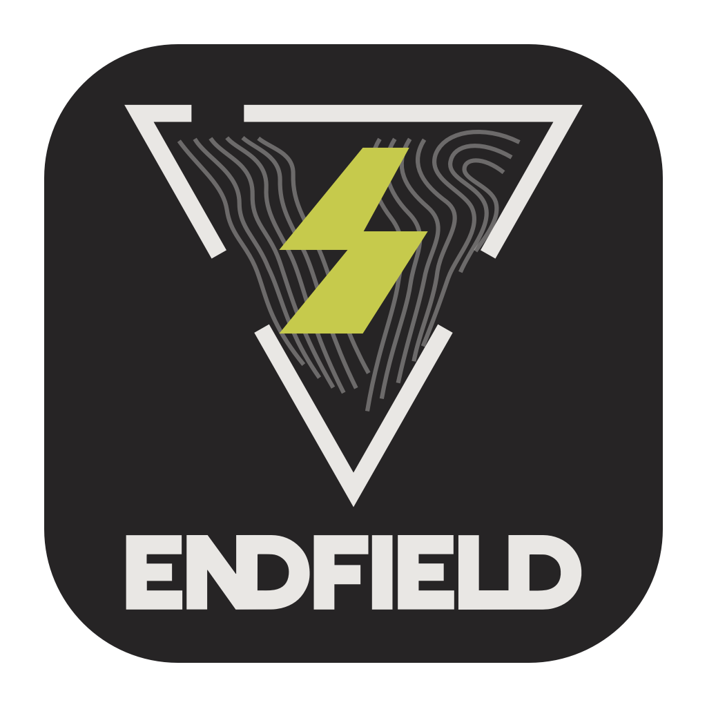
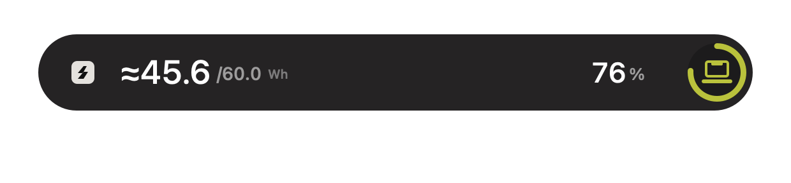
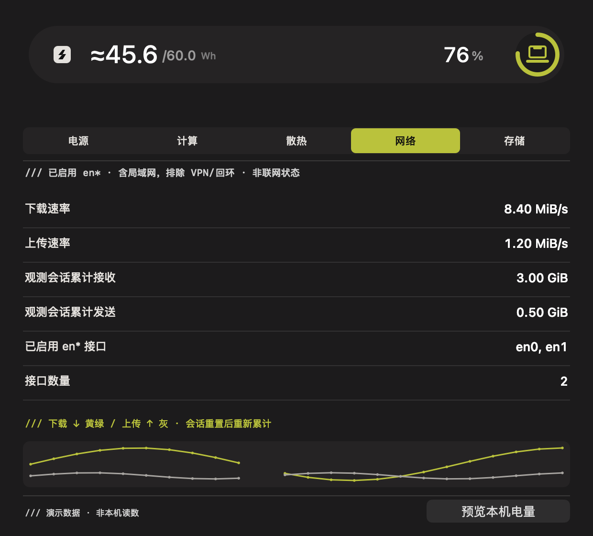
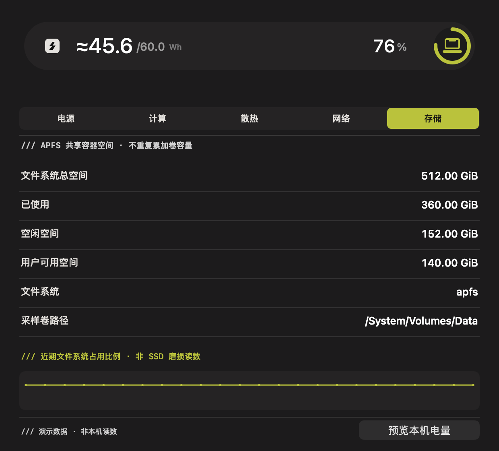
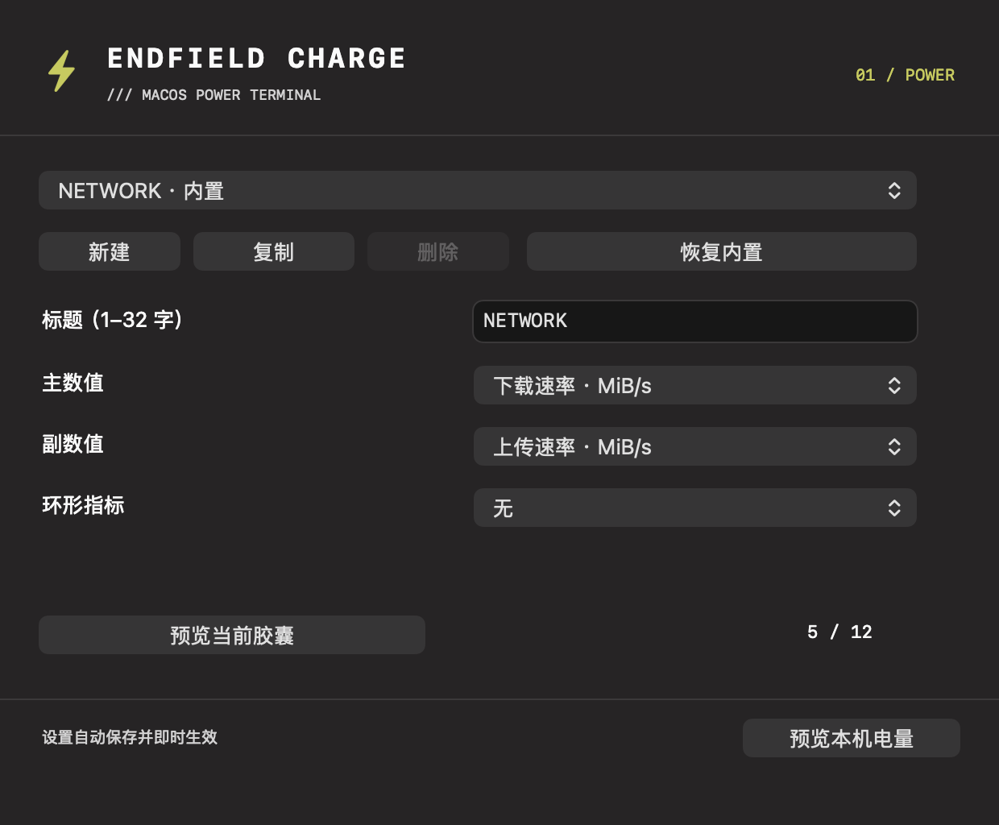
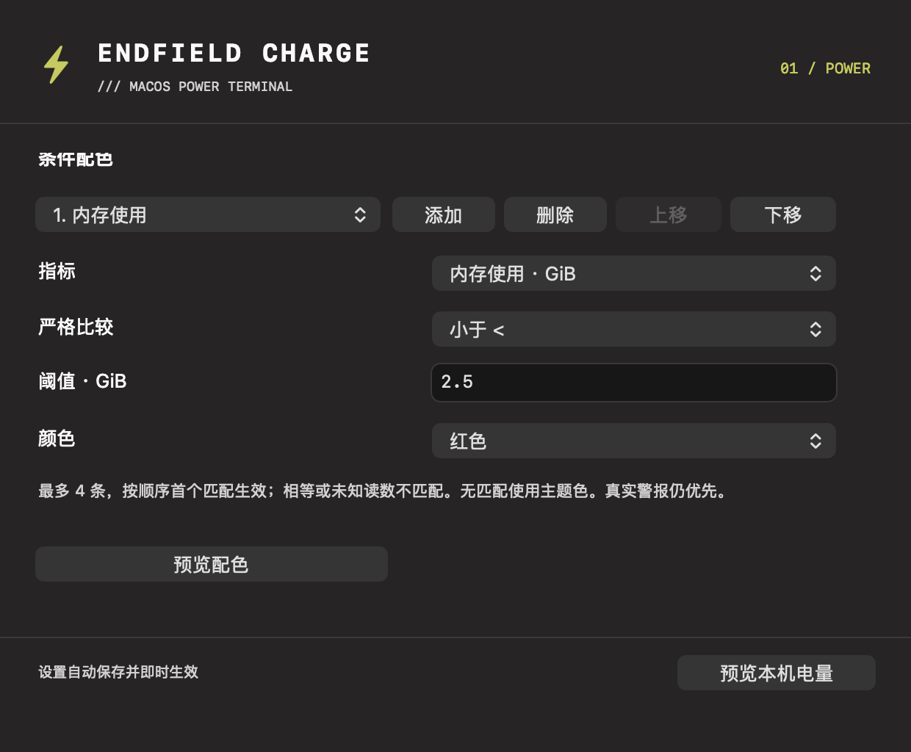

[English](README.md) | 简体中文



# Endfield Charge

为 **macOS** 打造的终末地风格电量 HUD 与本地遥测终端。

在屏幕顶部查看电源变化，检查系统遥测，定制胶囊与提醒。使用原生 Swift/AppKit，无需额外 Web 运行时。

[](https://github.com/MarkYang44/Endfield-Charge/releases/latest)


[](LICENSE)

**[下载 macOS 版](https://github.com/MarkYang44/Endfield-Charge/releases/latest)** · [快速上手](#快速上手) · [文档](#文档)

## 简介

Endfield Charge 是一个原生菜单栏应用。插拔充电器时，屏幕顶部依次显示电标、模式标题与电量胶囊。炭黑、灰白、黄绿色配色，以及几何图案和三段动画，参考 [QinAnze/zmd-charge](https://github.com/QinAnze/zmd-charge)。

独立的遥测窗口展示电源、计算、散热、网络和存储数据；自定义胶囊与阈值提醒共用常驻采样服务。支持简体中文、English 和跟随系统，升级保留原有设置。

## 界面预览

以下为真实 AppKit 界面的**演示数据导出图**，不是本机实测值。设置截图仅包含内容区，不含 macOS 标题栏与工具栏。

<table>
  <tr>
    <td width="50%"><strong>电量胶囊</strong><br></td>
    <td width="50%"><strong>网络遥测</strong><br></td>
  </tr>
  <tr>
    <td><strong>存储遥测</strong><br></td>
    <td><strong>胶囊编辑器</strong><br></td>
  </tr>
</table>



[更多真实分享、状态及播放实例](docs/configuration-sharing.zh-CN.md)。

## 主要功能

- **电源 HUD**：保留原三段几何与波纹方向，显示近似 Wh、电量和充电状态；支持多显示器、减少动态效果，不抢焦点、不拦截鼠标。
- **五类遥测**：电池侧功率与适配器额定值、CPU 与估算内存、系统热状态、已启用 `en*` 网卡接口流量、APFS Data 卷容量。缺失数据保持未知。
- **胶囊方案**：提供电量、CPU、内存、网络和存储预设，最多 12 项；可编辑标题、主副指标和可选圆环，通过菜单或快捷键预览当前方案。
- **Codex 额度（可选）**：在**设置 → 胶囊 → 当前胶囊 → Codex · 5小时／每周**中启用（菜单栏“选择胶囊”也可使用），左侧显示剩余百分比，中间为重置倒计时，右侧圆环使用官方 OpenAI 标识。需要已安装并登录的本机 Codex CLI；原五项默认方案保持不变。
- **分享与配色**：本地 `.endfield.json` 导入／导出，合并／替换预览和一份撤销备份；每胶囊最多 4 条有序主题／黄绿／琥珀／红色条件。详见[配置指南](docs/configuration-sharing.zh-CN.md)。
- **播放模式**：不重复队列、10–600 秒间隔，短暂模式播放一轮，或开启常驻紧凑显示；轮播和常驻默认关闭。
- **通用提醒**：最多 16 条数值阈值或热状态／内存压力变化规则，支持持续时间和冷却；新规则默认关闭，电源事件优先。
- **原生设置**：中文／English／跟随系统，可改全局快捷键，可选登录启动与菜单栏百分比；登录启动默认关闭。

## 安装

1. 从 [最新 Release](https://github.com/MarkYang44/Endfield-Charge/releases/latest) 下载 **`Endfield-Charge-macOS.zip`**。
2. 解压后，将 **`Endfield Charge.app`** 放入 **Applications（应用程序）**。
3. 启动应用，图标会出现在**菜单栏**。

需要 **macOS 13 或更新版本**。正式安装包同时包含 Apple Silicon 与 Intel 架构；使用应用无需安装 Swift、Python 或其他运行时。升级时替换应用，偏好设置独立保存。

安装包使用 ad-hoc 签名，**尚未经过 Apple 公证**。下载副本如被 macOS 拦截，请使用系统的“打开”或“隐私与安全性”确认流程，保持 Gatekeeper 开启。

## 快速上手

1. 点击菜单栏图标，进入**设置 → 通用**，选择语言与快捷键。
2. 点击**预览本机电量**，或插拔充电器，查看原电量 HUD。
3. 打开**遥测终端**查看五类数据；在**设置 → 遥测**中分别关闭不需要的模块。
4. 进入**设置 → 胶囊**选择、编辑方案，然后点击**预览当前胶囊**。
5. 在**胶囊**页向下滚动，设置**条件配色**、**播放队列**或打开**分享与导入…**；常驻在**显示**页单独开启。
6. 进入**设置 → 规则**新建阈值或状态变化提醒，再手动启用。

全新安装的默认快捷键为 **Control + Option + H**；可改为 **Command + Shift + E** 等组合，升级保留原有快捷键。快捷键先预览当前方案，开启轮播后再播放一轮队列；明确的电量预览和插拔电源事件仍显示原电量 HUD。

新启用的规则先建立安静基线：数值条件启动时已成立，需要先恢复再跨越阈值；状态规则等待下一次已知状态变化。后台每 30 秒评估，可能无法观察到短时变化。

## 数据来源与边界

| 读数 | 来源与含义 |
| --- | --- |
| 电池能量 | 根据可用的原始物理容量与电压估算 Wh，标注 `≈`；字段不可用显示 `—`，不写死本机电池容量。 |
| 功率 | 电池电压 × 有符号电流；适配器 W 为报告的额定值，不是实测整机功耗。“超充模式”为主题文案，不表示检测到快充协议。 |
| CPU／内存 | Mach 计数差分，以及活跃＋不可换出＋压缩占用估算；内存口径与活动监视器不同。 |
| 散热 | 系统公开热状态，不是 CPU 实测温度。 |
| 网络 | 已启用 `en*` 接口的原生 64 位计数，包含局域网，排除 VPN／回环接口；速率需要两次有效采样，累计仅覆盖观测会话，不是开机总流量。 |
| Codex 额度 | 通过已安装 Codex CLI 的公开本机 app-server 协议读取账户限额；仅支持 Codex 的 300／10,080 分钟窗口，剩余 = 100 − 已用。缺少 CLI、登录、窗口或数据时显示 `—`。 |
| 存储 | 对 APFS Data 卷调用 `statfs`，必要时回退根卷；总量、空闲和用户可用空间分开，不重复累加共享卷，也不读取 SSD 磨损。 |

Codex 仅在额度胶囊／配色条件可见或明确启用额度规则时，独立异步读取；结果在内存缓存约 5 分钟，已知重置时间可提前触发，重试至少间隔 60 秒，切换轮播会复用缓存。CLI 可能通过现有登录联系 OpenAI；本应用不读取凭据或对话，不发起模型任务，不管理登录，也不安装 CLI。重置时间由服务提供，可能变化。

共享调度器在遥测／胶囊可见需求下每 2 秒采样，后台工作每 30 秒采样；没有启用的显示或规则需要时，停止新增网络和存储采集。单个有界串行后台队列执行采集，过期结果会丢弃。曲线仅保留当前窗口会话最多 300 个点，缺失数据断开连线。

## 隐私与性能

显示的读数与偏好保留在本机；系统遥测没有主动联网探测、自动遥测上传或长期历史。可选 Codex 账户读取使用已安装 CLI 的服务连接。偏好存储于 `com.markyang.endfieldcharge` 的 UserDefaults 域；不需要辅助功能或录屏权限。

设置与遥测界面使用按需进程，关闭窗口后退出；常驻保留菜单、快捷键和监听服务。v1.2.0 候选安装包的默认、轮播及常驻开销与测量限制见 [v1.2.0 验证](docs/capsule-sharing-validation.md) 和 [分版本性能记录](docs/PERFORMANCE.md)。

## 开发

需要 **Swift 6 工具链**以及 Xcode 或 Apple Command Line Tools，无第三方包依赖。

```bash
git clone https://github.com/MarkYang44/Endfield-Charge.git
cd Endfield-Charge
bash scripts/verify.sh core
bash scripts/build-app.sh --universal
```

本机有图形桌面时，可额外运行 `bash scripts/check-runtime.sh` 检查原生窗口、编辑器、通信与提醒。CI 运行不依赖桌面的核心测试并生成双架构安装包；版本标签会自动发布 Release。

## 文档

| 文档 | 内容 |
| --- | --- |
| [开发指南](docs/DEVELOPMENT.zh-CN.md) · [English](docs/DEVELOPMENT.md) | 构建、命令行导出、项目结构与发布流程 |
| [性能记录](docs/PERFORMANCE.md) | 分版本测量、口径与限制 |
| [分享与播放指南](docs/configuration-sharing.zh-CN.md) · [English](docs/configuration-sharing.md) | 导入／撤销、配色、状态规则及播放默认值和边界 |
| [v1.2.0 验证](docs/capsule-sharing-validation.md) | 当前候选版本测试、图案回归、安装包与实测开销 |
| [v1.1.0 验证](docs/telemetry-plus-validation.md) | 功能、生命周期、安装包与公开发布检查 |
| [发行说明](https://github.com/MarkYang44/Endfield-Charge/releases) | 正式安装包与版本变化 |
| [第三方声明](THIRD_PARTY_NOTICES.md) | 上游代码、设计与图案来源 |

## 许可与致谢

新增代码使用 [MIT](LICENSE)。视觉设计参考 [QinAnze/zmd-charge](https://github.com/QinAnze/zmd-charge)，网络、存储与配置机制借鉴 [GlacierGlimmer/zmd-charge-plus-for-macos](https://github.com/GlacierGlimmer/zmd-charge-plus-for-macos)，相关版权与许可随应用保留。

终末地图案和商标权归原权利人所有，代码许可不授予品牌图案权利。本项目为独立非官方工具，与游戏开发商无隶属或认可关系；详见 [第三方声明](THIRD_PARTY_NOTICES.md)。
