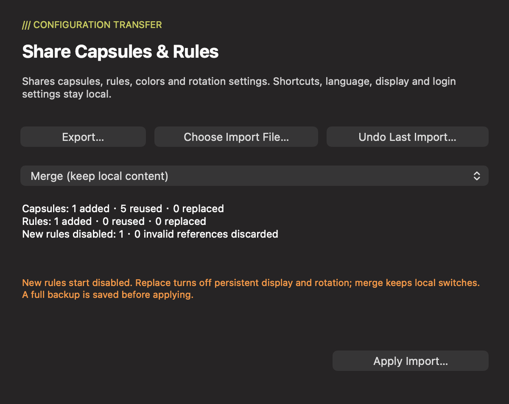
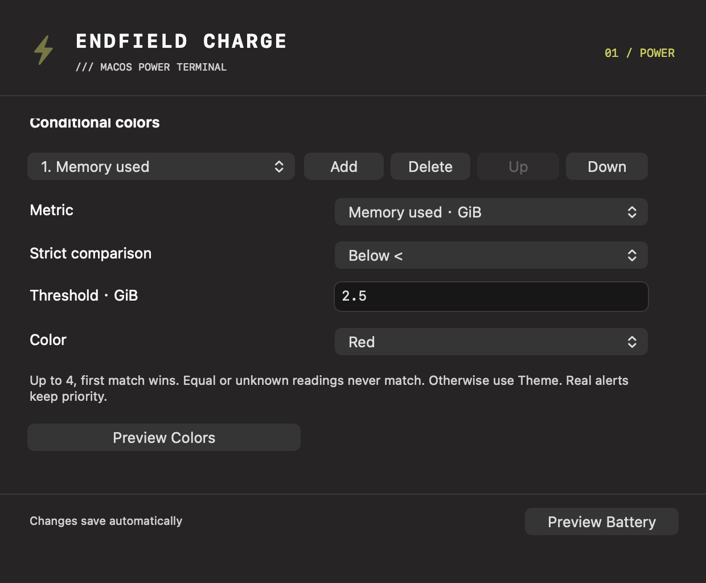
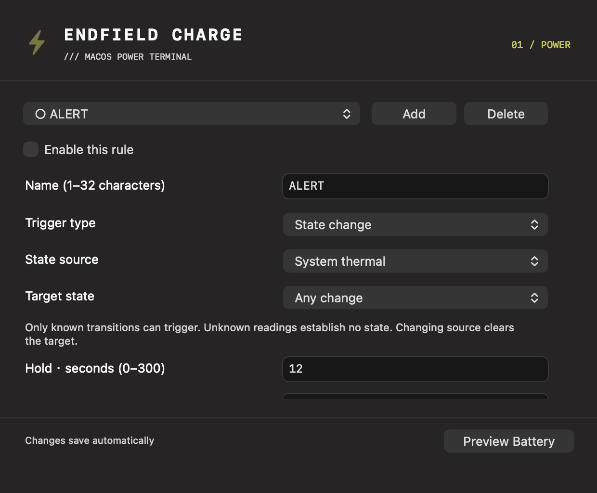
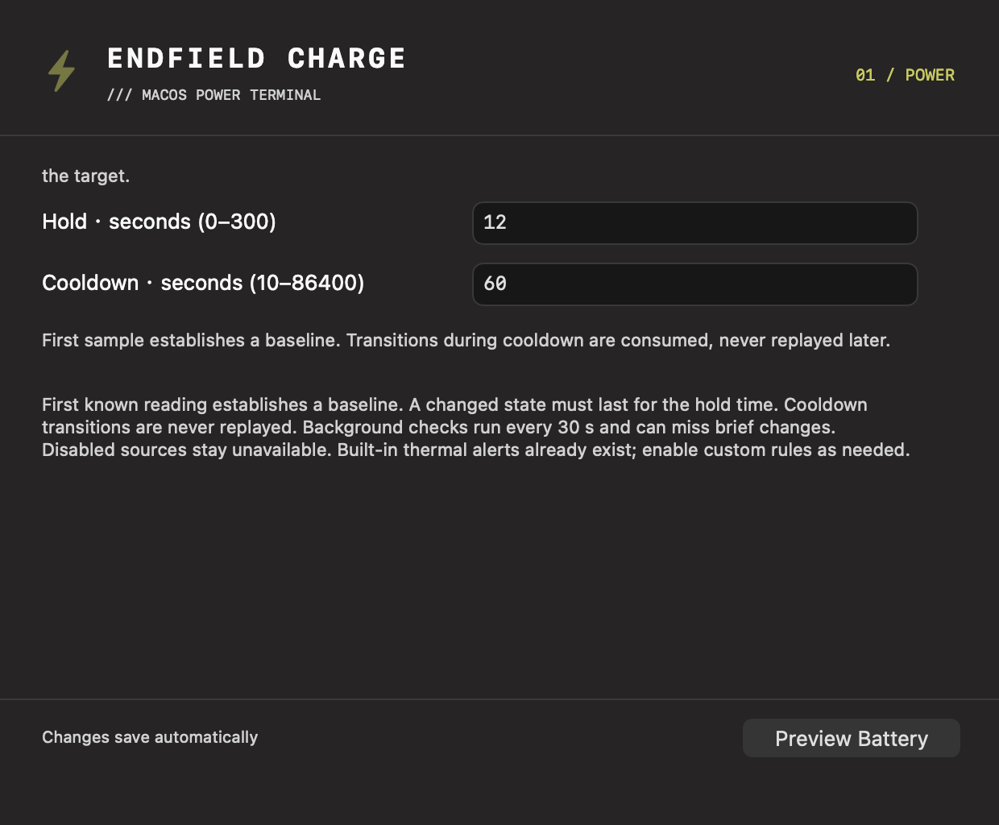
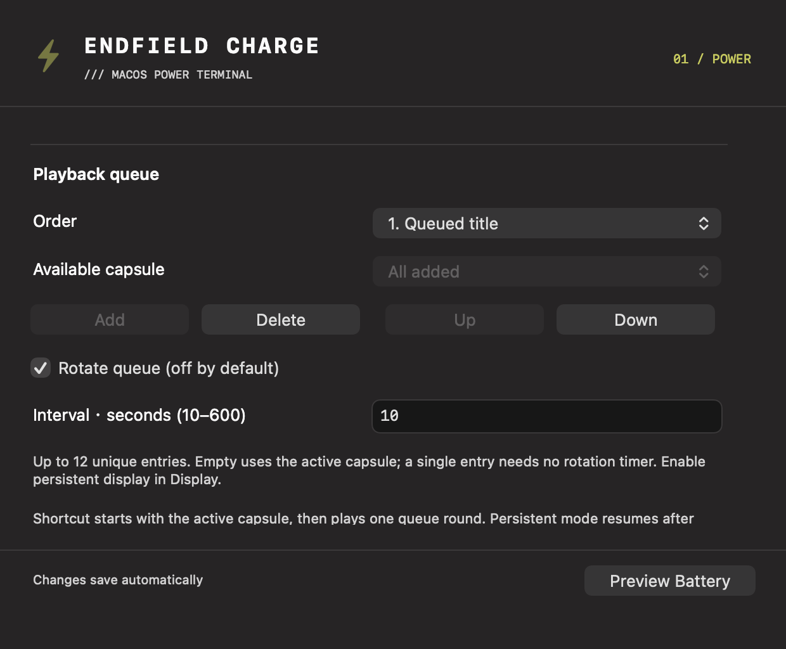
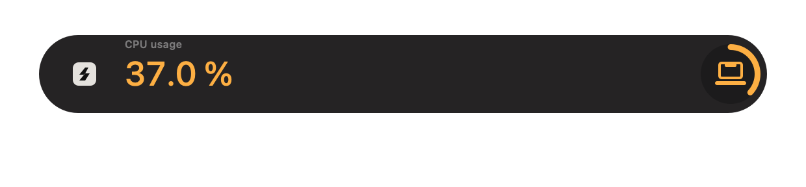
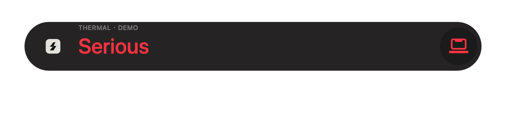
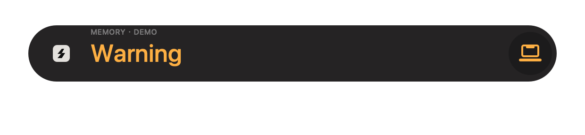

English | [简体中文](configuration-sharing.zh-CN.md)

# Sharing, colors, state rules and playback

All examples use synthetic demo configurations. These features use the existing native HUD and shared sampler; no extra runtime or account is required.

## Share and undo

Open **Settings → Capsules**, scroll down to **Sharing & Import…**, then **Export…** to save a local `.endfield.json`. To import, choose **Choose Import File…**, inspect the preview, select **Merge (keep local content)** or **Replace shared content**, then **Apply Import…** and confirm. Cancel leaves the configuration unchanged.

Shares contain capsule profiles, ordered color conditions, alert rules, the selected capsule, and playback queue/interval. They exclude language, shortcut, display placement, login startup, device readings and other local preferences. Sharing does not upload anything. The format has its own format identifier and schemaVersion; it does **not** import arbitrary zmd-charge-plus JSON.

- **Merge** retains local content and enabled rules. Identical items are reused; differing ID collisions become imported copies, and queue references are remapped. Modified built-ins become custom copies. Local persistent/rotation switches keep their values; newly imported rules are disabled.
- **Replace** changes only the shared scope, preserves a default battery capsule, disables imported rules, and turns persistent display and rotation off. Missing selection falls back to battery. Review discarded references in the preview before applying.
- Every import first atomically stores one full pre-import preference snapshot in the app's Application Support directory. **Undo Last Import…** restores that most recent snapshot; another import replaces the backup. Undo does not change macOS login-item registration. This backup can include local preferences and should remain private.
- A changed configuration makes an older preview stale. Open the preview again and review it. Invalid files, capacity overflow or backup/storage failure leave current preferences unchanged; no silent truncation occurs during merge.

The share file and private IPC frame limits are 128 KiB (131,072 bytes; IPC excludes its newline). Limits: 12 profiles, 16 combined numeric/state rules, four ordered colors per profile, names 1–32 characters/1,024 UTF-8 bytes, IDs at most 64 characters/256 bytes. Unknown versions/enums, duplicate IDs, nonfinite numbers and invalid fields are rejected. Legacy preference migration remains separate and tolerant.

## Conditional colors

In **Settings → Capsules**, scroll to **Conditional colors**, add a condition, choose a numeric metric, strict Above/Below comparison, threshold in the displayed units, and Theme/Lime/Amber/Red. Use the condition selector and Up/Down to set priority; **Preview Colors** uses the actual HUD. Invalid or unfinished IME input must be corrected before structural changes.

The first matching known condition wins. Equality does not match; unknown readings are skipped. No match uses the original theme. Colors change the numeric/ring accent, not artwork or geometry, and do not create alerts. Real power/low-battery/thermal alerts keep their priority and severity colors. An unchanged battery profile uses the original rendering path.

## Typed state rules

In **Settings → Rules**, add a rule and choose **State change**, then **System thermal** or **Memory pressure**. Select Any Change or a known target, hold 0–300 seconds and cooldown 10–86400 seconds. Enable the rule explicitly; new and imported rules start disabled. The total rule limit includes threshold rules.

The first known sample after enabling/editing/restarting a module or waking establishes a quiet baseline. Unknown samples or gaps over 60 seconds clear pending transitions; they do not bypass cooldown. A transition during cooldown is consumed, not replayed later. Hold measures sampled observations, not uninterrupted monitoring. Changing state restarts the hold. Background evaluation is every 30 seconds and can miss brief changes. Network inactivity is not connectivity detection; no active network probe is added.

State alerts show the rule name plus a localized state label (the source is chosen in the editor): warning/elevated is amber, serious/critical is red, normal uses the theme. A simultaneous built-in thermal warning suppresses the duplicate thermal-rule presentation.

## Queue and persistent display

In **Settings → Capsules → Playback queue**, add unique profiles, move them Up/Down, set 10–600 seconds (default 15), and explicitly enable **Rotate queue**. **Settings → Display → Keep capsule visible (off by default)** enables a compact hold. Both switches default off; upgrading preserves previous settings and shortcut.

The shortcut starts with the selected capsule, then plays one finite queue round in transient mode; editor previews show a single item. Persistent mode animates once and holds compact values; rotation loops the queue with compact transitions. A single item needs no rotation timer. An empty queue disables rotation and uses the active capsule. Disabled metric modules stay unknown.

Power events take priority over alerts, then manual preview, then ambient playback. Alerts/previews resume persistent display with a fresh full dwell. Menu-bar hide/resume pauses playback and releases its sampling demand; independent alerts and power events remain active. Sleep clears pending events, and wake waits for a fresh sample before restoring playback. Static compact holds do not run the 60 Hz animation timer; visible sampling stays at the existing two-second cadence.

HUD examples below are production HUDView/CapsulePresentation exports with synthetic CPU/thermal/memory values, not real readings or edited UI:

See [v1.2.0 validation](capsule-sharing-validation.md) for tests, unchanged-artwork checks, package details and measured costs.
