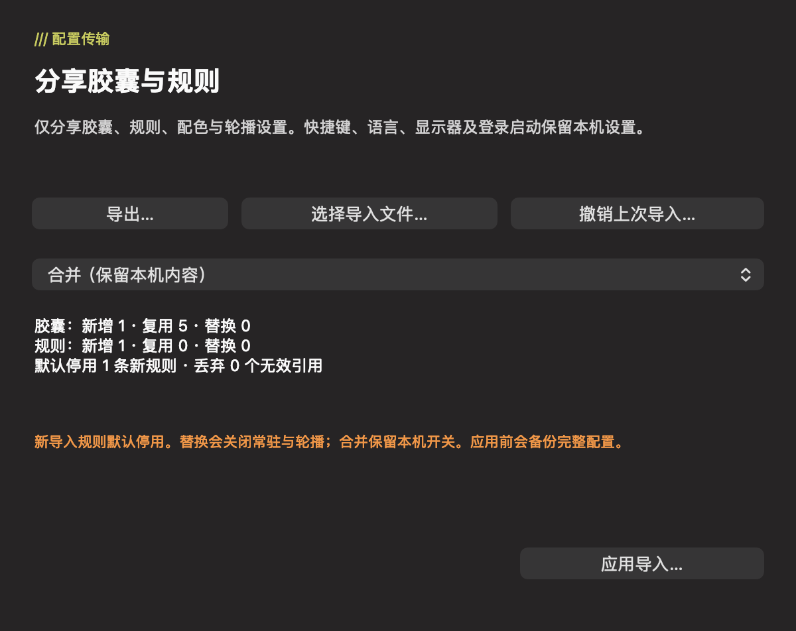
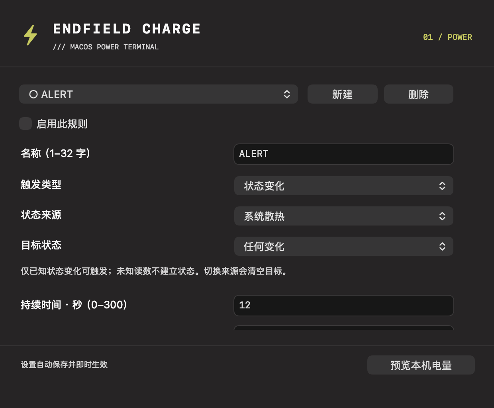
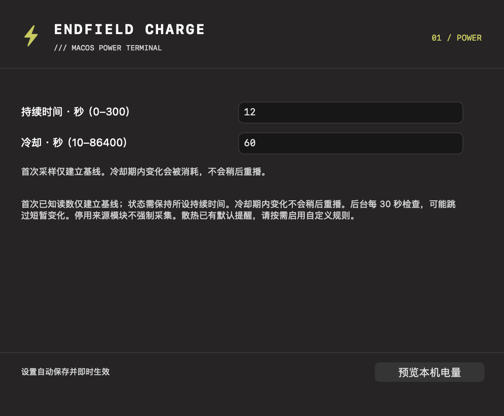
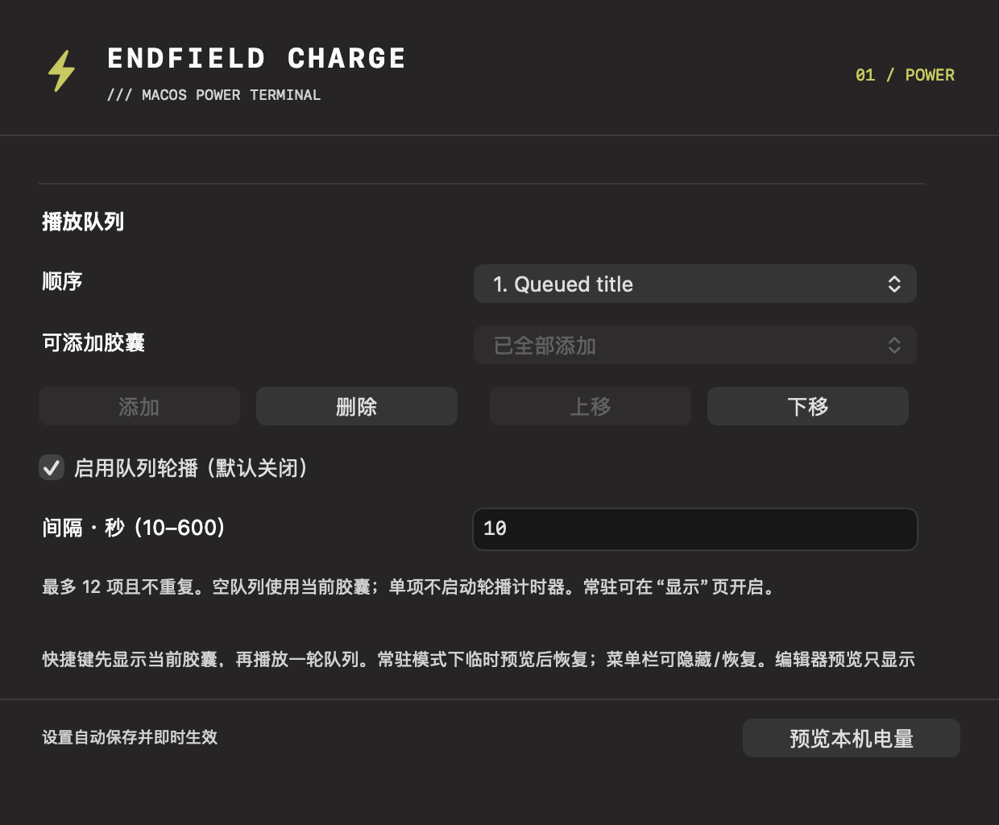
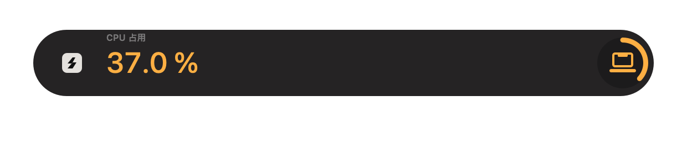

[English](configuration-sharing.md) | 简体中文

# 分享、配色、状态规则与播放

所有示例均为合成演示配置。新功能沿用原生 HUD 和共享采样器，无需额外运行时或账号。

## 分享与撤销

进入**设置 → 胶囊**，向下滚动到**分享与导入…**，点击**导出…**保存本地 `.endfield.json`。点击**选择导入文件…**后先检查预览，选择**合并（保留本机内容）**或**替换分享内容**，再点击**应用导入…**并确认；取消不改变配置。

分享包含胶囊、有序配色条件、提醒规则、当前胶囊和轮播队列／间隔；不包含语言、快捷键、显示位置、登录启动、设备读数及其他本机偏好。文件不会上传。格式有自己的标识与 schemaVersion，**不支持任意 zmd-charge-plus JSON**。

- **合并**保留本机内容与已启用规则。相同项目复用，不同内容的冲突 ID 生成导入副本并重映射队列引用；修改过的内置方案作为自定义副本导入。本机常驻／轮播开关保留原值，新导入规则停用。
- **替换**仅修改分享范围，保留默认电池胶囊；导入规则、常驻和轮播关闭。选择失效时回退电池，应用前检查预览列出的无效引用。
- 每次导入先在应用专属 Application Support 目录原子保存一份完整偏好快照。**撤销上次导入…**恢复最近这一份，后续导入覆盖备份；撤销不更改 macOS 登录项注册。备份可能含本机偏好，请留在本机。
- 预览后配置变化会使预览过期，请重新查看。无效文件、容量超限或备份／保存失败均保留当前配置；合并不静默截断。

分享文件及私有 IPC 每帧最多 128 KiB（131072 字节，IPC 不含换行）；最多 12 胶囊、16 条数值／状态规则合计、每胶囊 4 条颜色条件。名称 1–32 字且最多 1024 UTF-8 字节，ID 最多 64 字／256 字节。未知版本或枚举、重复 ID、非有限数及越界字段拒绝导入；旧偏好迁移单独宽容处理。

## 条件配色

在**设置 → 胶囊**滚动到**条件配色**，添加条件，选择数值指标、严格大于／小于、显示单位下的阈值与主题／黄绿／琥珀／红色色板。用条件选择器及上移／下移调整优先级，**预览配色**调用真实 HUD。无效或未完成的输入法草稿需先修正，才能改动结构。

第一条已知读数命中的条件生效；等于阈值不命中，未知读数跳过，无命中使用原主题。只改数值与圆环强调色，不改图案或几何，也不自动创建提醒。电源／低电量／热提醒保持优先级及严重度颜色；未修改的电池方案沿用原绘制路径。

## 有类型的状态规则

在**设置 → 规则**添加规则，选择**状态变化**，来源选**系统散热**或**内存压力**，再选任意变化或已知目标，设置保持 0–300 秒和冷却 10–86400 秒。规则需手动启用；新建与导入规则默认停用，总数与阈值规则共用 16 条上限。

启用、修改、模块重启或唤醒后的首个已知采样只建立安静基线。未知采样或超过 60 秒的间隔清除待确认变化，但不能绕过冷却。冷却期间发生的变化直接消耗，不会事后补播；状态改变会重新计保持时间。保持表示采样观测，不是连续监控。后台每 30 秒评估，可能错过短暂变化。网络无流量不等于离线，不增加主动联网探测。

状态胶囊显示规则名称与双语状态标签（来源在编辑器中选择）；警告／轻度压力为琥珀色，严重／临界为红色，正常为主题色。内置热提醒同时成立时，抑制重复的热状态规则展示。

## 队列与常驻

在**设置 → 胶囊 → 播放队列**添加不重复方案，用上移／下移排序，设置 10–600 秒间隔（默认 15 秒），显式开启轮播；**设置 → 显示 → 常驻显示胶囊（默认关闭）**开启紧凑保持。两个开关默认关闭，升级保留原偏好和快捷键。

快捷键先显示当前选择，短暂模式再播放一轮有限队列；编辑器预览只显示一项。常驻首次播放动画后保持紧凑数值；常驻轮播循环队列，仅做紧凑过渡。单项不需轮播计时器，空队列关闭轮播并使用当前胶囊；关闭的指标模块保持未知。

电源事件优先于提醒，其次手动预览，再到常驻／自动轮播。提醒或预览结束后恢复常驻并重新计满停留时间。菜单栏隐藏／恢复暂停播放并释放相应采样需求，独立提醒与电源事件仍有效。睡眠清空待播内容，唤醒等待新采样后再恢复。紧凑静态阶段没有 60 Hz 动画计时器，可见采样维持原有 2 秒节奏。

以下为生产 HUDView／CapsulePresentation 使用合成 CPU、热状态与内存压力导出的实例，并非本机读数或后期拼图：

测试、原图案回归、安装包与实测开销见 [v1.2.0 验证](capsule-sharing-validation.md)。
